  

  Integration engineer from Poland 🇵🇱 · Azure, .NET &amp; messaging by day, indie Windows apps by night. 
  I like software that is <b>fast</b>, <b>local-first</b> and <b>respects your machine</b>: low RAM, no forced cloud, no accounts.

  
  
  

## 🛠️ What I'm shipping

  <a href="https://inspeak.pro"><b>Website</b></a> ·
  <a href="https://github.com/Presoon/inSpeak-releases/releases/latest"><b>Download latest</b></a> ·
  <a href="https://github.com/Presoon/inSpeak-releases"><b>Releases repo</b></a>

  <a href="https://inflows.pro"><b>Website</b></a> ·
  Built for people who live in Service Bus dead-letter queues

  <a href="https://github.com/Presoon/usagewatch"><b>Source</b></a> ·
  <a href="https://github.com/Presoon/usagewatch/releases/latest"><b>Download latest</b></a> ·
  <a href="https://usagewatch.seev.pro"><b>Website</b></a> ·
  PRs with new providers welcome ⭐

## 🧰 Toolbox

   
  

## 🧭 How I build

- **Native and lean first.** inSpeak runs speech recognition fully on-device with NativeAOT and keeps its UI in a separate process, so the resident app stays light.
- **Measure, don't guess.** Every release is checked end to end: installer hash, auto-update, real latency numbers.
- **Self-hosted all the way.** The websites above run on my own homelab: Docker, Caddy and GitHub Actions runners with automatic rollback.
- **AI agents as teammates.** I ship with Claude Code and Codex daily, which is exactly why I built UsageWatch.

  Questions, ideas or bug reports? Open an issue in the project repo.

